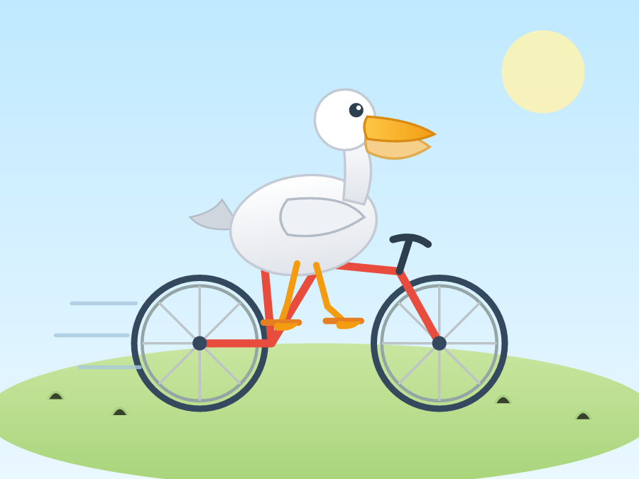
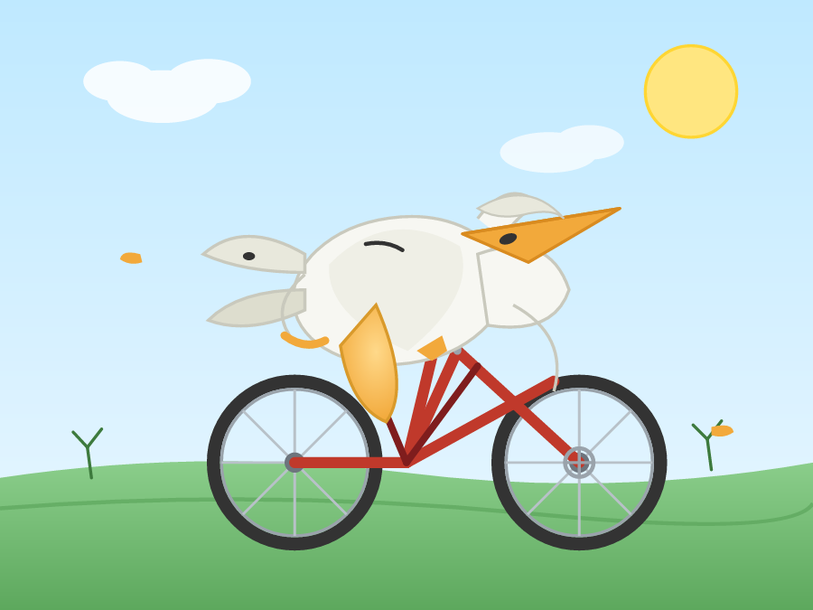
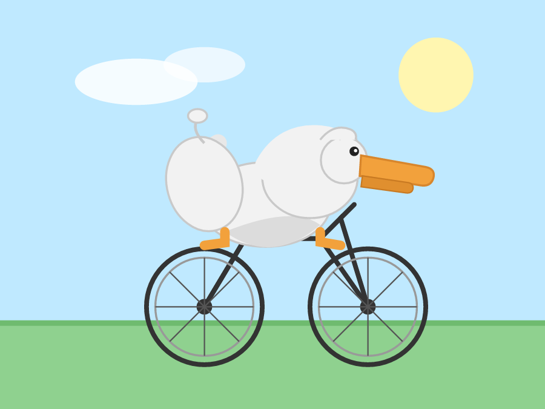
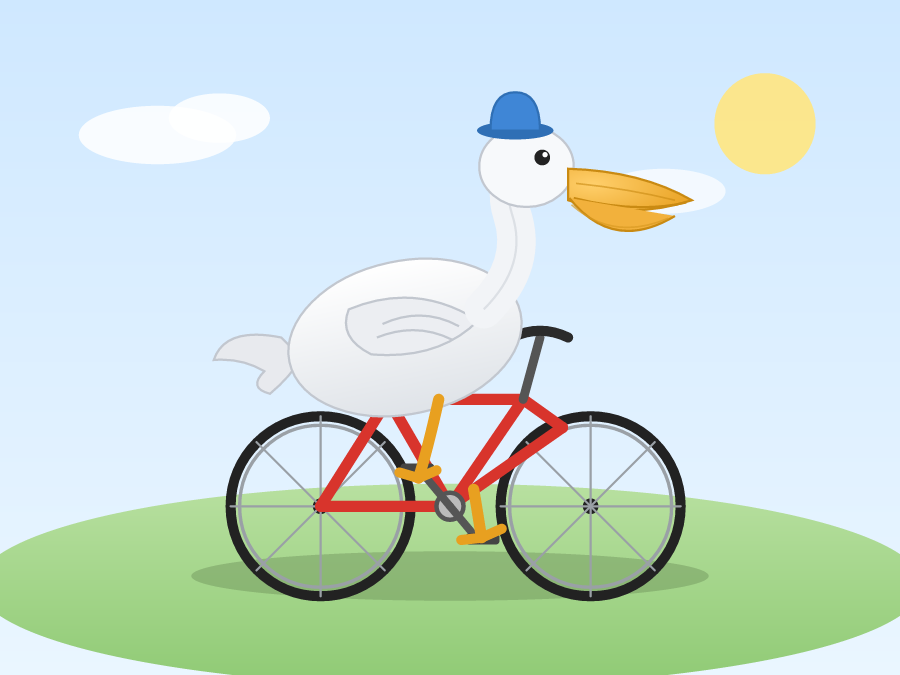
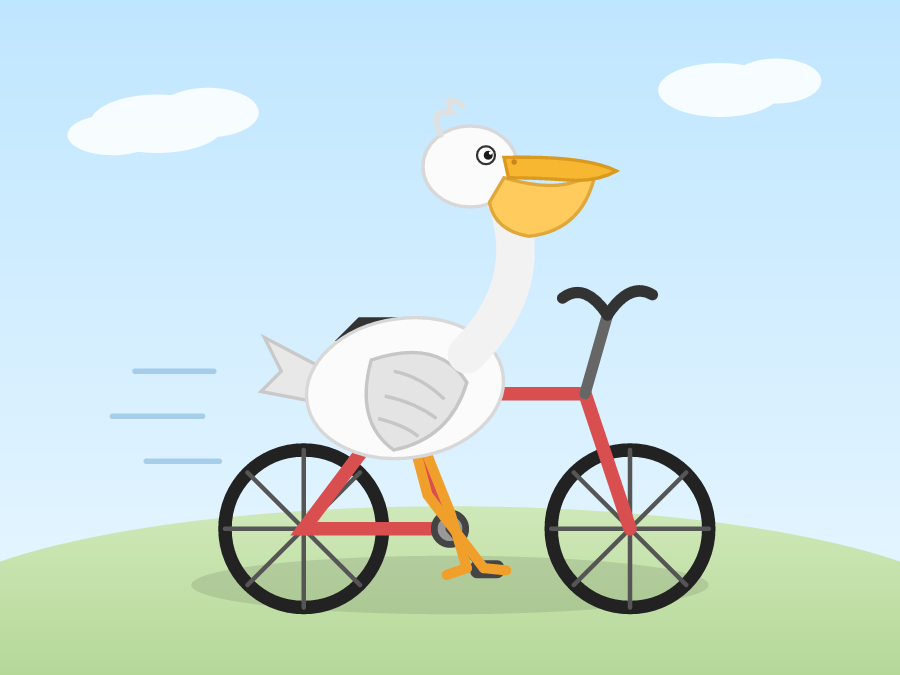
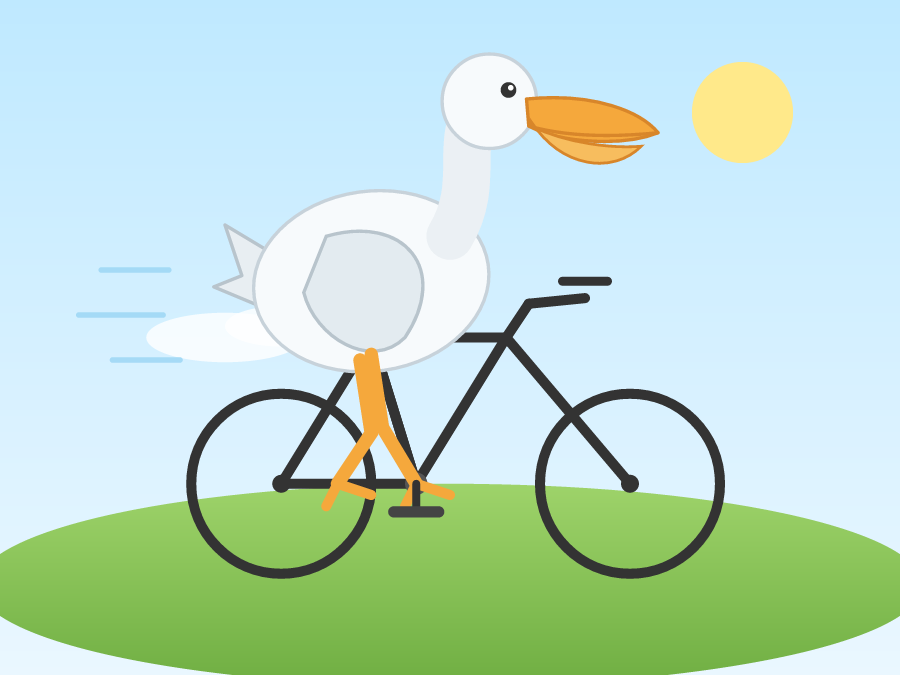

# 做题 A/B：同一个模型，装 / 不装 dsh-frontline

用 Simon Willison 的「鹈鹕骑车」题（[Pelicans on a bicycle, 2024-10-25](https://simonwillison.net/2024/Oct/25/pelicans-on-a-bicycle/)）
加 5 道可机器判定的题，对比插件安装前后的**做题结果**，而不是运行时开销（后者见 [REPORT.md](./REPORT.md)）。

- 模型：`deepseek-flash`，`thinking: disabled`（避免思考占用输出预算）
- 系统提示词：本机真实 DSH system message，± frontline 的六段（即 `raw/real-system-with.txt` / `without.txt`）
- 采样：每题每臂 3 次，交替执行，共 36 次
- 判分：代码题用隐藏测试真实执行；SVG 用 `@resvg/resvg-wasm` 真实渲染；视觉分由人（本 agent）看渲染图按 4 项各 0–2 打分

## 成绩单

| 题目 | 判定方式 | 安装 | 未安装 |
| --- | --- | --- | --- |
| 鹈鹕骑自行车 SVG | 合法 SVG + 可渲染 | 3/3 | 3/3 |
|  | 只输出 SVG（无解释文字） | **3/3** | 1/3 |
|  | 视觉评分（主观，满分 24） | 18.5 | 23 |
| 括号匹配 `balanced()` | 8 条隐藏测试 × 3 次 | **24/24** | **24/24** |
| 修复死循环二分查找 | 8 条隐藏测试 × 3 次 | **24/24** | **24/24** |
| 球棒与球（1.10 美元） | 结论 = 0.05 | 3/3 | 3/3 |
| 3 句解释 API（含 contract 恰 1 次） | 句数 + 词频 | 3/3 | 3/3 |
| 40 词杯子文案 | 恰好 40 词 | 1/3 | 1/3 |

**结论：做题正确率打平。** 代码、算术、指令题两臂完全同分；观察到的差异只有输出形式（安装臂 3/3 严格只给 SVG，未安装臂 2/3 多说了话，n=3 不足以定性），以及每次调用多约 50–70 ms（prefill 多 3,110 tokens，与 REPORT 的测量一致）。鹈鹕的视觉分差（18.5 vs 23）来自 3 张样本里的 2 张差图，样本太小，不能归因于插件。

## 鹈鹕：6 张渲染图

题面（逐字来自上述基准，末尾加了一句给直答 API 用的约束）：

> Generate an SVG of a pelican riding a bicycle. Output only the SVG code — no markdown fences, no explanation.

> 为什么要加末尾这句：本机真实 system prompt 是「coding agent」，用逐字原题跑时两臂 6/6 都回了一个工具调用（DSML 语法，想先 `ls` 再写文件），文本里 0 个 SVG——这是测量通道（直接调模型 API、不执行工具）的产物，不是插件差异。加「只输出 SVG」后两臂都能直答。

### 安装（with）

| r0（8/8） | r1（6/8） | r2（4.5/8） |
| --- | --- | --- |
|  |  |  |

### 未安装（without）

| r0（8/8） | r1（8/8） | r2（7/8） |
| --- | --- | --- |
|  |  |  |

视觉评分四维：鹈鹕可辨认（体/喙/喉囊）、自行车可辨认（双轮/车架/车把）、真的在骑（坐垫/踏板/握把）、构图（背景、比例、遮挡）。缺车架、腿穿模、姿态拧巴各扣分。

具体差在哪：

- `with r2`：只有两个轮子＋一根竖杆，没有车架，鹈鹕像浮在轮子上（4.5）。
- `with r1`：鹈鹕身体扭转、头颈关系不清，勉强能读出是鸟（6）。
- `without r0`：蓝帽子鹈鹕＋完整红色车架＋双脚踏板，构图最好（8）。
- `with r0`、`without r1`、`without r2`：都是完整可读的「鹈鹕骑车」，差异只在细节。

## 成本（做题侧）

每题每臂 3 次输出 token 与中位耗时：

| 题目 | 安装 tokens / 中位 ms | 未安装 tokens / 中位 ms |
| --- | --- | --- |
| 鹈鹕 | 1947/2362/1241 · 208 ms | 2404/2038/1469 · 164 ms |
| 括号匹配 | 77/77/99 · 201 ms | 77/82/82 · 164 ms |
| 二分修复 | 88/88/88 · 244 ms | 88/88/88 · 174 ms |
| 球棒与球 | 91/44/53 · 217 ms | 119/93/123 · 187 ms |
| API 三句 | 44/60/34 · 198 ms | 46/42/51 · 222 ms |
| 40 词文案 | 50/49/46 · 282 ms | 50/53/45 · 167 ms |
| **合计** | **6,538** | **7,038** |

输出总量接近（安装臂还少 7%，主要由鹈鹕的随机差异贡献）；单次调用耗时安装臂普遍 +30–80 ms，来自固定多出的 3,110 tokens prefill。

## 观察

1. **插件不改变"会不会做"**：两臂在代码、算术、指令题上同分；40 词精确计数两臂都是 1/3——这是模型自身的能力边界，不是插件能修的。
2. **插件改变"怎么交"**：只输出 SVG 3/3 vs 1/3；身份段没有泄进任何一道题的回答（36 次里 0 次提到 Astra），说明它主要影响身份题与格式纪律，不影响解题。
3. **鹈鹕样本不足以判优劣**：3 张里 2 张差图，元素数两臂相当（69/84/41 vs 76/66/48），更像绘图方差。要下结论需要 ≥20 张/臂并做盲评。
4. **成本是固定的**：每个请求 +3,110 tokens（之前实测），做题越多付得越多；正确率不因此提高。

## 局限

- 每臂 3 次，单模型（deepseek-flash），单网络环境。
- 视觉分是单人主观评分，不是盲评、不是 judge 模型；图片就贴在上面，可以自己重打。
- 直接调模型 API，不执行工具；因此代码题只验证"写出来的代码能不能过隐藏测试"，不验证 agent 在 DSH 里跑测试的完整链路。
- 题目数量小，只能说明"这 6 道上没有正确率差异"，不能外推成"插件对做题无影响"。

## 复现

```bash
# 需要 DEEPSEEK_API_KEY 与 @resvg/resvg-wasm（仅渲染用）
REPS=3 DEEPSEEK_API_KEY=… node bench/tasks/run_tasks.mjs
RESVG_DIR=/path/to/@resvg/resvg-wasm RESVG_WASM=/path/to/@resvg/resvg-wasm/index_bg.wasm \
  node bench/tasks/score.mjs
```

原始回答与判分：`bench/tasks/out/answers.json`、`bench/tasks/out/results.json`；SVG/PNG 同目录。
